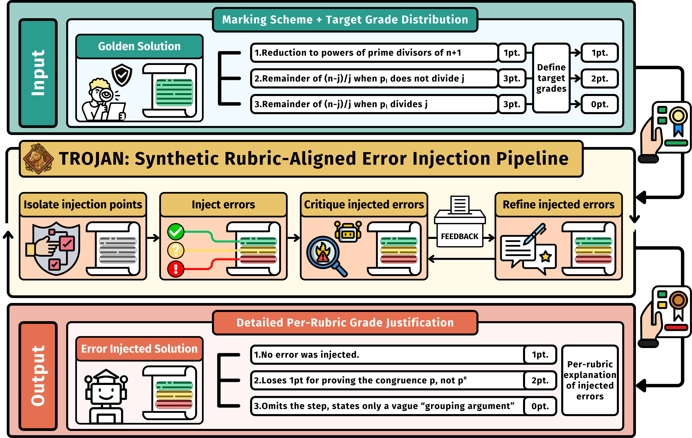

# TROJAN: Synthetic Error-Injected Proof Gradings


Azim Ospanov <sup>1,</sup><sup>2</sup>, Zijin Feng <sup>1</sup>, Ding Ding <sup>1,</sup><sup>3</sup>, Chengwu Liu <sup>1</sup>, Haoli Bai <sup>1</sup>, Jiacheng Sun <sup>1</sup>, Lifeng Shang <sup>1</sup>, Farzan Farnia <sup>2</sup>


<sup>1</sup> <sub>**Huawei Foundation Model Department**, </sub> <sup>2</sup> <sub>**The Chinese University of Hong Kong**, </sub> <sup>3</sup> <sub>**The Hong Kong University of Science and Technology**</sub>

<div align="center" style="line-height: 1;">
  <a href="https://huggingface.co/datasets/aziksh/TROJAN-BENCH-S" target="_blank" style="margin: 2px;">
    
  </a>
  <a href="https://huggingface.co/datasets/aziksh/TROJAN-BENCH-H" target="_blank" style="margin: 2px;">
    
  </a>
</div>

TROJAN generates **graded student proofs with known ground-truth scores** for olympiad-style math
problems. For each problem it picks a target score profile (how many points each rubric criterion
should earn), asks an LLM to write a realistic student proof that earns *exactly* those points, and
then refines the proof with an LLM critic until the critic agrees the solution is aligned with target grade.

The result is a benchmark for **LLM-as-a-judge graders**: a good judge should recover the injected
score.

**Released benchmarks:**

1. [`error_injected_datasets/trojan_bench_s.json`](error_injected_datasets/trojan_bench_s.json)
(200 proofs, 50 from each of IMC 2025, IMO 2025, USAMO 2025 and USAMO 2026).

2. [`error_injected_datasets/trojan_bench_h.json`](error_injected_datasets/trojan_bench_h.json)
(50 human graded proofs from USMAO 2025).



---

## Contents

1. [Quick start](#quick-start)
2. [Using the benchmark](#using-the-benchmark)
3. [How it works](#how-it-works)
4. [Repository layout](#repository-layout)
5. [Configuring models](#configuring-models)
6. [Generating samples](#generating-samples)
7. [Building a benchmark](#building-a-benchmark)
8. [Converting and validating files](#converting-and-validating-files)
9. [Data formats](#data-formats)
10. [Prompt templates](#prompt-templates)
11. [Caveats](#caveats)
12. [Bibtex Citation](#bibtex-citation)

---

## Quick start

Requires Python 3.9+ (tested on 3.13). **Run every script from inside `TROJAN/`**, because all
default paths are relative to it.

```bash
cd TROJAN
pip install -r requirements.txt
cp llm_config.example.json llm_config.json   # then put your API key(s) in llm_config.json
```

Validate the shipped benchmark (no API key needed):

```bash
python bench_format.py check error_injected_datasets/trojan_bench_s.json
```

Generate 10 error-injected proofs for IMO 2025:

```bash
python generate_error_injected.py original_datasets/MathArena__imo_2025__train.json \
    --model deepseek-v3.2-no-thinking --n 10 --max-iterations 3 --num-threads 4 --seed 0
```

---

## Using the benchmark

Each record in `trojan_bench_s.json` contains a problem, its rubric, an error-injected proof, and
the ground-truth score per rubric criterion:

```python
import json

bench = json.load(open("error_injected_datasets/trojan_bench_s.json", encoding="utf-8"))
rec = bench[0]
rec["problem"], rec["solution"], rec["grading_scheme"]   # judge inputs
rec["awarded_points"]                                     # ground-truth total (0..max_points)
[c["awarded_points"] for c in rec["grading_scheme"]]      # ground truth per criterion
```

Give the judge `problem`, `solution`, and the rubric (`title`, `desc`, `max_points` of each
criterion), plus `sample_solution` if your setup uses a reference. Hide `awarded_points` and
`justification`, because `justification` explains exactly where the points were lost.

| Statistic | Value |
|---|---|
| Records | 200 (50 × `imc_2025`, `imo_2025`, `usamo_2025`, `usamo_2026`) |
| `max_points` | 7 for every record |
| `awarded_points` distribution (score: count) | 0: 8, 1: 27, 2: 36, 3: 53, 4: 37, 5: 26, 6: 13 |
| Generator / critic / refiner model | `claude-opus-4-6-thinking`, `--max-iterations 5`, `--convergence-threshold 2` |


A second file, [`error_injected_datasets/trojan_bench_h.json`](error_injected_datasets/trojan_bench_h.json),
holds 48 **human-annotated** gradings of the six USAMO 2025 problems (8 per problem). This pipeline
does not produce it, and it uses a different schema (see [Data formats](#human-annotated-set-trojan_bench_hjson)).

---

## How it works

### 1. Sample target score profiles

Each problem has a rubric (`grading_scheme`): a list of criteria, each worth `points`. A score profile
assigns every criterion an integer in `0..points`. `generate_error_injected.py` enumerates every
possible profile, **drops the perfect score**, and samples profiles uniformly without replacement.

The `--n` samples are spread evenly across the problems that have a `sample_solution`; the first
`n mod #problems` problems get one extra. A problem can't yield more samples than it has non-perfect
profiles. Example: criteria worth 1, 3, 2, 1 points give 2·4·3·2 = 48 profiles, 47 of them
non-perfect.

### 2. Generate → Critique → Refine

All three roles use the same model. Each role has its own prompt template:

- **Generator** ([`templates/error_injection_template_one_shot.txt`](templates/error_injection_template_one_shot.txt))
  gets the problem, the rubric, the reference solution, and a readable score profile. It must keep
  full-marks sections rigorous and put a *believable* error, sized to the deduction (minor, moderate
  or full), into every criterion that loses points. Its output is a `# Candidate Solution` section
  followed by `# Grader's Notes`, which explains each deduction. The prompt includes one worked example.
- **Critic** ([`templates/critique_template.txt`](templates/critique_template.txt)) grades the
  candidate on each criterion independently (temperature 0.3) and returns JSON: `criteria[]`
  (`target_score`, `actual_score`, `aligned`, `feedback`), `overall_aligned`, and
  `revision_guidance`. If the JSON cannot be parsed, the round counts as not aligned and the raw
  text becomes the revision guidance.
- **Refiner** ([`templates/refinement_template.txt`](templates/refinement_template.txt)) makes
  minimal edits based on the critique. It leaves aligned sections alone and makes each misaligned
  error stronger or weaker as needed.

A sample **converges** when the critic returns `overall_aligned: true` on `--convergence-threshold`
consecutive rounds. Any misaligned round resets the count and triggers a refinement. Samples that
never converge are still saved, with `"converged": false`. `--max-iterations 0` gives single-shot
generation with no critique.

### 3. Post-process into benchmark format

Each run writes the full trace (every intermediate candidate and critique) **and** a
benchmark-format file. The conversion strips the `# Candidate Solution` / `# Grader's Notes` headers,
moves the Grader's Notes into `justification`, and renames fields. `build_benchmark.py` then merges
runs per competition and draws a seeded random subset.

---

## Repository layout

```
TROJAN/
├── generate_error_injected.py   # Main pipeline: profile sampling + Generate→Critique→Refine
├── bench_format.py              # Raw → benchmark conversion and validation (library + CLI)
├── build_benchmark.py           # Merge runs, sample per dataset, write a benchmark file
├── models/
│   └── template_generator.py    # OpenAI-compatible client, retries, template rendering
├── templates/                   # Generator / critic / refiner prompts
├── llm_config.example.json      # Model registry template; copy to llm_config.json (git-ignored)
├── original_datasets/           # Source problems (MathArena dumps from Hugging Face)
├── error_injected_datasets/     # Released benchmark files; new runs are written here
├── assets/trojan.png            # Pipeline diagram
├── download_dataset.py          # Fetch a Hugging Face dataset into original_datasets/
└── requirements.txt             # openai, backoff, datasets
```

Source problems in `original_datasets/` (all have a `sample_solution`, all problems are worth 7):

| File | Problems |
|---|---|
| `MathArena__imc_2025__train.json` | 10 |
| `MathArena__imo_2025__train.json` | 6 |
| `MathArena__usamo_2025__train.json` | 6 |
| `MathArena__usamo_2026__train.json` | 6 |

To fetch another dataset (`datasets` is only needed for this script):

```bash
python download_dataset.py MathArena/usamo_2025 --split train
# → original_datasets/MathArena__usamo_2025__train.json
```

---

## Configuring models

`llm_config.json` maps a model key (passed as `--model`) to its connection settings. Start from
[`llm_config.example.json`](llm_config.example.json):

```jsonc
{
  "claude-opus-4-6-thinking": {
    "name": "claude-opus-4-6-thinking",        // model id sent to the API
    "api":  "YOUR_API_KEY",
    "url":  "https://<openai-compatible-endpoint>/v1",
    "max_tokens": 65536                             // output budget per call (default 8192)
  }
}
```

`llm_config.json` is listed in `.gitignore`, so your keys stay out of version control. Pass a
different file with `--config`.

Any OpenAI-compatible endpoint works (OpenAI, DeepSeek, proxy gateways, and so on). Routing happens
in [`models/template_generator.py`](models/template_generator.py):

- Models whose `name` is `gpt-5`, `gpt-5-mini` or `gpt-5.4` use the **Responses API** with
  `reasoning.effort = "high"` and `text.verbosity = "high"`.
- Every other model uses **Chat Completions** with `temperature=0.7`, `top_p=0.95`, `seed=42`, and a
  300 s timeout.
- Transient errors (connection, timeout, rate limit, 5xx) are retried with exponential backoff and
  jitter (up to 6 tries or 120 s). Each sample is also retried up to 3 times on
  `ConnectionError` / `OSError`. Any other exception, such as a 400 error, is recorded as a failed
  sample, and the run continues.

---

## Generating samples

```bash
python generate_error_injected.py original_datasets/MathArena__imo_2025__train.json \
    --model claude-opus-4-6-thinking \
    --n 300 \
    --max-iterations 5 \
    --convergence-threshold 2 \
    --num-threads 16 \
    --seed 42
```

| Argument | Default | Meaning |
|---|---|---|
| `input` | — | Problem JSON (see [Input problems](#input-problems)) |
| `--n` | `10` | Total samples, spread evenly across problems |
| `--model` | `deepseek-v3.2-no-thinking` | Key in `llm_config.json` |
| `--max-iterations` | `3` | Max critique rounds per sample; `0` = single-shot |
| `--convergence-threshold` | `1` | Consecutive aligned critiques needed to accept |
| `--num-threads` | `1` | Samples processed in parallel |
| `--seed` | none | Seed for score-profile sampling |
| `--output-dir` | `error_injected_datasets` | Where outputs are written |
| `--name` | auto | Overrides the output file stem (see below) |
| `--dataset-tag` | from input | `problem_idx` prefix in the benchmark file, such as `imo_2025` |
| `--template` / `--critique-template` / `--refine-template` | `templates/...` | Prompt templates |
| `--config` | `llm_config.json` | Model registry |

Each run writes **two files** to `--output-dir`:

```
<model>_<stem>.json         raw trace, one entry per sample (including failures)
<model>_<stem>_bench.json   benchmark format, successful samples only
```

`<stem>` is `--name` if given; otherwise it is
`<input stem>_conv_threshold_<t>_max_iterations_<m>_num_threads_<k>_seed_<s>`.

`--dataset-tag` defaults to the middle part of an `Org__name__split` filename
(`MathArena__imo_2025__train.json` → `imo_2025`). For any other filename it is the whole stem; this
includes files downloaded with `--subset`, which have four parts. In that case, pass the tag
yourself.

At the end of the run you see a validation report for the benchmark file and one summary line with
the converged count, error count and total tokens. With `--num-threads > 1`, progress lines from
different samples are interleaved.

---

## Building a benchmark

`build_benchmark.py` merges one or more raw trace files per competition, drops failed samples, draws
`--per-dataset` records per competition with a single seeded RNG (datasets are processed in the order
given), sorts each subset by problem, assigns ids, and validates the result.

```bash
python build_benchmark.py \
    --dataset imo_2025=error_injected_datasets/runA.json,error_injected_datasets/runB.json \
    --dataset usamo_2025=error_injected_datasets/usamo_2025_run.json \
    --per-dataset 30 --seed 0 \
    --output my_bench.json
```

Use `--per-dataset -1` to keep every successful sample.

> **Note:** the raw generation traces behind `trojan_bench_s.json` are **not included** in this
> repository. Running `build_benchmark.py` without `--dataset` looks for them at
> `error_injected_datasets/{imc_2025,imo_2025,usamo_2025,usamo_2026}.json` (50 per dataset, seed 10)
> and fails with `FileNotFoundError` if they are absent. Those defaults are the settings that
> were used to build `trojan_bench_s.json`.

---

## Converting and validating files

```bash
# Convert raw trace(s) of one competition to benchmark format
python bench_format.py convert error_injected_datasets/<raw>.json \
    --dataset-tag imo_2025 -o imo_2025_bench.json

# Validate files against the benchmark format (non-zero exit status on errors)
python bench_format.py check error_injected_datasets/trojan_bench_s.json
```

An empty `solution`, or an empty `justification` (the LLM left out `# Grader's Notes`), is reported
as a warning, not an error.

From Python:

```python
from bench_format import to_bench_records, validate_bench_records

records = to_bench_records(raw_results, dataset_tag="imo_2025")
errors, warnings = validate_bench_records(records)
```

---

## Data formats

### Input problems

A JSON list in the MathArena layout:

```json
[
  {
    "problem_idx": "1",
    "problem": "Let $k$ and $d$ be positive integers. Prove that ...",
    "points": 7,
    "grading_scheme": [
      {"title": "Initial closed form expression for each digit", "points": 1, "desc": "Uses the base-2n ..."},
      {"title": "Interchanging the floor and mod",               "points": 3, "desc": "Transforms the ..."}
    ],
    "sample_solution": "We claim one such $N$ is ..."
  }
]
```

- `sample_solution` is **required**. Problems without it are skipped.
- Criterion text may be in `desc` or `description`.
- `points` (the problem total) is optional and defaults to the sum of the criterion points.

### Benchmark format (`*_bench.json`, `trojan_bench_s.json`)

Every record has exactly these keys, in this order:

| Field | Type | Description |
|---|---|---|
| `problem_idx` | str | `<dataset_tag>_problem_<idx>_id_<i>`, where `i` is the 0-based position within the dataset |
| `problem` | str | Problem statement |
| `max_points` | int | Maximum total score |
| `awarded_points` | int | Ground-truth (target) total score |
| `solution` | str | Error-injected proof, with headers and Grader's Notes removed |
| `sample_solution` | str | Reference solution |
| `token_usage` | object | `{prompt_tokens, completion_tokens, total_tokens}` spent generating this sample |
| `justification` | str | The generator's Grader's Notes: which criteria lose points, and why |
| `grading_scheme` | list | `[{title, max_points, awarded_points, desc}]`: the rubric with per-criterion ground truth |

`bench_format.py check` enforces:

- `sum(grading_scheme[].max_points) == max_points`
- `sum(grading_scheme[].awarded_points) == awarded_points`
- `0 <= awarded_points <= max_points` for every criterion
- `problem_idx` values are unique

Example (fields truncated):

```json
{
    "problem_idx": "imc_2025_problem_1_id_0",
    "problem": "Let $P \\in \\mathbb{R}[x]$ be a polynomial ...",
    "max_points": 7,
    "awarded_points": 5,
    "solution": "**(a)** Let $(a, b) \\in \\mathbb{R}^2$ be an arbitrary point. ...",
    "sample_solution": "(a) Suppose that the degree of $P$ is odd ...",
    "token_usage": {"prompt_tokens": 17293, "completion_tokens": 24113, "total_tokens": 41406},
    "justification": "- **Uneven degree (0/1):** The student correctly computes ...",
    "grading_scheme": [
        {"title": "Functional Equation", "max_points": 2, "awarded_points": 2, "desc": "The model reduces ..."}
    ]
}
```

Files are written as UTF-8 JSON with 4-space indentation and no ASCII escaping.

### Raw trace (`<model>_<stem>.json`)

The raw trace keeps everything, for debugging and analysis:

| Field | Description |
|---|---|
| `problem_idx` | Problem id from the source dataset |
| `problem` | Problem statement |
| `max_points` / `awarded_points` | Problem total / **target** total score |
| `solution_grading_scheme` | `[{title, description, max_points, awarded_points}]`: the target profile per criterion |
| `solution` | Final candidate: raw LLM text, including `# Candidate Solution` and `# Grader's Notes` |
| `initial_solution` | Generator output before any refinement |
| `original_sample_solution` | Reference solution |
| `refinement_iterations` | Number of critique rounds run |
| `converged` | Whether the convergence threshold was reached |
| `critique_history` | One entry per round: `iteration`, `candidate_solution`, `overall_aligned`, `criteria[]`, `revision_guidance` |
| `token_usage` | `prompt_tokens`, `completion_tokens`, `total_tokens`, summed over every call for this sample |

A sample that failed with an exception is stored as `{"problem_idx": ..., "error": "..."}`.

### Human-annotated set (`trojan_bench_h.json`)

48 records with the keys `problem_idx` (`"1"`–`"6"`), `global_idx` (1–48), `problem`,
`grading_scheme` (the source rubric: `title`, `points`, `desc`), `sample_solution`, `solution`,
`awarded_points`, and `justification`. It has only a total score, with no per-criterion ground
truth, so `bench_format.py check` reports it as invalid. That is expected.

---

## Prompt templates

Templates are rendered with Python `str.format`:

- The pipeline fills `{problem}`, `{grading_scheme}`, `{correct_solution}`, `{score_profile}`,
  `{candidate_solution}` (critic and refiner only), and `{critique}` (refiner only).
- Lists and dicts (the rubric, the critique) are inserted as indented JSON.
- **Literal braces in a template must be doubled** (`{{`, `}}`). This matters for LaTeX such as
  `\frac{{n}}{{2}}` and for JSON examples. Braces inside the inserted values need no escaping.
- A template that uses a placeholder the pipeline doesn't provide raises
  `ValueError: Missing required template variables`.

The generator and refiner must keep the `# Candidate Solution` / `# Grader's Notes` layout, because
the benchmark conversion splits on those headers. The critic must return a JSON object with an
`overall_aligned` boolean.

---

## Caveats

- **The target score is the ground truth.** `awarded_points` is the score the generator was *asked*
  to hit, not an independently verified grade. Converged samples were confirmed by the critic
  `convergence_threshold` times in a row. Non-converged samples are kept in raw files and can be
  sampled into a benchmark; filter on `converged` in the raw trace if you need stricter data.
- **The last refinement of a non-converged sample is never critiqued.** If the final round is
  misaligned, the refiner still runs and its output becomes `solution`.
- **Failed samples are dropped** from benchmark files. Check the raw file's `error` entries to see
  what went wrong (usually timeouts or rate limits on long thinking calls).
- **Reproducibility:** `--seed` fixes only the score profiles. LLM outputs are non-deterministic,
  even with `seed=42` sent to Chat Completions.

## Bibtex Citation
```bibtex
@inproceedings{
   ospanov2026llmgrading,
   title={Can LLMs Reliably Grade Olympiad Proofs? A Controlled Study of Mathematical Verification with LLMs},
   author={Azim Ospanov and Zijin Feng and Ding Ding and Chengwu Liu and Haoli Bai and Jiacheng Sun and Lifeng Shang and Farzan Farnia},
   booktitle={The Fortieth Annual Conference on Neural Information Processing Systems},
   year={2026}
}
```
